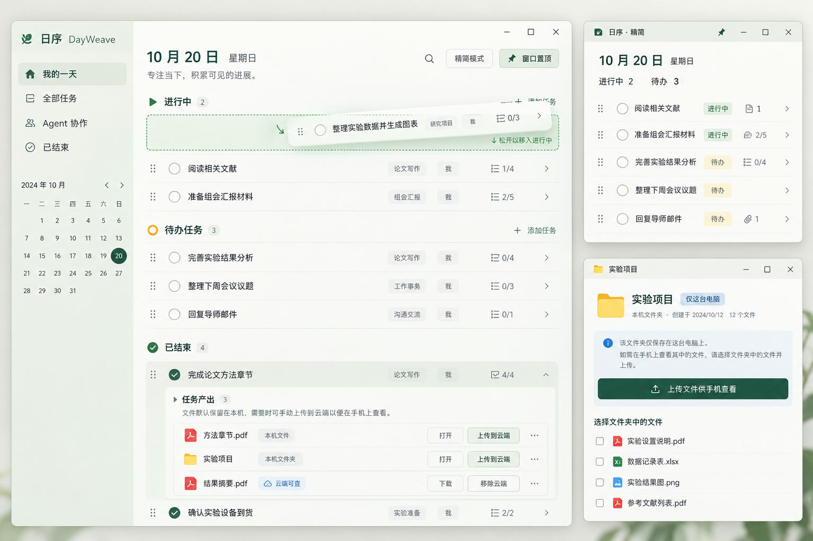

# 日序 DayWeave

面向个人与 AI Agent 并行工作的轻量任务应用。Windows 客户端使用 Tauri 2 + 系统 WebView2，界面由 React 与 TypeScript 编写，同一套界面可运行于网页，适配手机屏幕。



[手机设计图](docs/design/dayweave-mobile-v2.png) · [设计提示词](docs/design/imagegen-v2-prompts.md)

任务类型补充设计：[电脑](docs/design/dayweave-task-types-desktop.png) · [手机](docs/design/dayweave-task-types-mobile.png) · [提示词](docs/design/task-types-prompts.md)。以上设计图均在对应功能编码前生成。

## v0.2.2 功能

- 按日期创建任务、提前安排其他日期；周视图、月历与历史日期跳转。
- 待办任务 / 进行中 / 已结束；状态分组和每个任务可展开或折叠。
- 区分「计划任务」和「零碎问题」：前者用绿色清单图标，后者用琥珀色扳手、文字标签和浅色底；精简窗口仍显示不同图标。类型独立于状态和优先级。
- 按任务类型筛选，在零碎问题筛选下创建任务时默认选中该类型；编辑时可随时转换。旧任务默认归为计划任务。
- 拖动任务左侧把手，在状态分组之间移动或调整顺序；手机支持触控拖动，键盘支持空格提起、方向键选状态、回车放下。
- Windows 去掉系统标题栏，窗口按钮融入应用右上角；拖动顶部空白区域移动窗口，双击最大化或还原，滚动时窗口按钮仍可用。
- 精简任务视图；Windows 客户端缩为小窗口，可置顶、最小化，并恢复完整窗口。
- 每项任务可关联产出文档或项目文件夹，已结束任务也可继续添加。文件默认只保存在本机，逐项确认后才上传私有云端副本。
- 子步骤、备注、项目标签、优先级、今日重点、关联链接。
- 执行者可填自己、Codex、Claude 等；Agent 视图与等待反馈标记。
- IndexedDB 本机保存，Supabase Auth + Postgres + Realtime 账号同步。
- 版本冲突保留双方内容，可选择本机版本、云端版本或保留两个版本。
- 软删除回收站、JSON 备份导入导出、搜索与执行者筛选。
- 响应式布局、键盘快捷键、网页离线缓存与 PWA 安装支持。

## 开发

需要 Node.js 24、Rust stable；Windows 打包需要 Visual Studio C++ Build Tools、Windows SDK 和 WebView2。

```powershell
npm ci
Copy-Item .env.example .env.local
# 在 .env.local 填写项目 URL 和 publishable key
npm run dev
npm run desktop:dev
```

未填写云配置时自动使用本机模式。数据库密码、secret key、service_role key 不应放进客户端或提交到仓库。客户端只使用 URL 与 publishable key，个人任务由数据库 RLS 规则隔离。

## 构建与检查

```powershell
npm test
npm run test:e2e
npm run desktop:build
```

Windows 安装包输出到 `src-tauri/target/release/bundle/nsis/`；`src-tauri/target/release/dayweave.exe` 是可直接运行的程序。安装包为开发首版，尚未配置商业代码签名。

端到端测试默认使用 Playwright Chromium。本机可设 `$env:PLAYWRIGHT_CHANNEL='msedge'` 使用 Edge。测试运行生产构建，覆盖离线刷新、持久化、子步骤、日期、拖拽、精简视图、本机附件、删除恢复和两种屏幕布局。原生附件逻辑另可在 `src-tauri` 运行 `cargo test --lib` 检查。

## 产出文件如何保存

- **Windows 关联**：保留原文件或文件夹的位置，只记录本机关联，不复制、不自动上传；原文件移动后可重新关联。文件名和类型随任务同步，完整本机路径不会上传。
- **网页本机文件**：文件内容保存在当前浏览器的 IndexedDB，单个最多 25 MB；清理网站数据会清除这些副本。浏览器不直接访问 Windows 的项目文件夹。
- **手机查阅**：登录同一账号，在原电脑点击该附件的「上传到云端」并确认，手机同步后即可下载。云空间为私有，按账号隔离。需要先发布网页或以后安装 Android 客户端，才能跨设备打开应用。
- **文件夹上传**：Windows 将所选文件夹内的普通文件（含隐藏文件和子目录）打包为 ZIP；单次最多 25 MB、2000 项，不跟随符号链接。上传是当时内容的快照，本机后续修改不会自动重传。
- **改回仅本机**：先保留当前设备的副本，再删除云端对象；已经下载到其他设备的副本仍在那些设备上。移除任务中的关联不会删除本机原文件。
- **备份范围**：JSON 备份包含任务和附件名称等元数据，不包含文件内容或本机路径。文档和项目文件夹请另行备份。

## 云端初始化

在自己新建的 Supabase 项目中按顺序执行 `supabase/migrations/` 下的迁移。`commit_task` 在登录用户权限下执行，使用版本号进行原子比较，重复请求使用 mutation ID 去重；任务删除作为文档中的墓碑同步。

首次使用：打开「设置与同步」→ 注册邮箱账号 → 完成邮箱确认 → 登录。同一账号的电脑与网页会自动同步。登录前的离线任务保持独立，可用「复制离线任务到账号」手动导入；退出后回到本机任务空间。示例数据只会在主动点击体验按钮后加入本机。

`tests/rls.sql` 可在开发项目用 postgres 权限执行，测试事务会回滚。`scripts/verify-cloud.mjs` 是显式运行的真实云端集成检查，只可使用可清理的开发测试账号；账号文件放在忽略的 `artifacts/` 目录，不会上传。

## GitHub Actions

CI 检查类型、单元测试和桌面 / 手机浏览器交互。手动运行 Windows 工作流可生成安装包；在仓库 Variables 配置 `SUPABASE_URL` 与 `SUPABASE_PUBLISHABLE_KEY` 才会包含该项目的云连接，未配置时为本机模式。锁定的 npm 与 Rust 依赖均随源码提交。

## 当前边界

- Android 已有响应式界面与共用数据模型，原生 APK 尚未打包；后续需要 Android SDK / NDK 和真机验证。
- 网页构建已可运行，尚未发布公网域名。网页离线功能需要 HTTPS 或 localhost，并至少联网打开一次。
- Agent 执行者与等待反馈用于任务组织，当前不会自动调度外部 Agent，也不会读取其进程状态。
- 循环任务、系统提醒、托盘常驻、全局快捷捕获、Agent Webhook 与自动更新列入后续规划。
- 本机任务默认保存在应用的 WebView 数据目录或浏览器 IndexedDB；应定期导出备份。
- 建议各端使用同一新版客户端；早于 v0.2.1 的版本不识别任务类型，混用旧版编辑可能让该任务回到默认类型。

更多产品建议、阶段取舍和验收说明见 [产品设计与路线](docs/product-plan.md)、[窗口顶栏验证](docs/verification-titlebar.md)、[任务类型验证](docs/verification-task-types.md)、[v0.2 验证记录](docs/verification-v2.md) 与 [v0.1 验证记录](docs/verification.md)。
