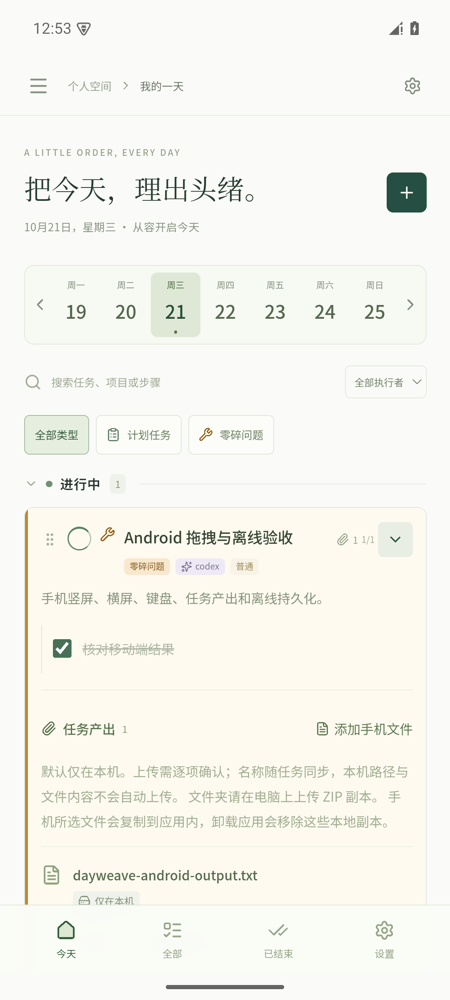
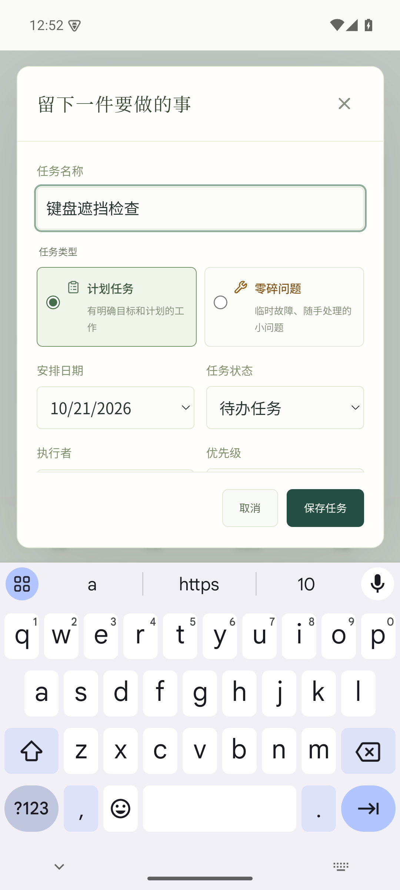
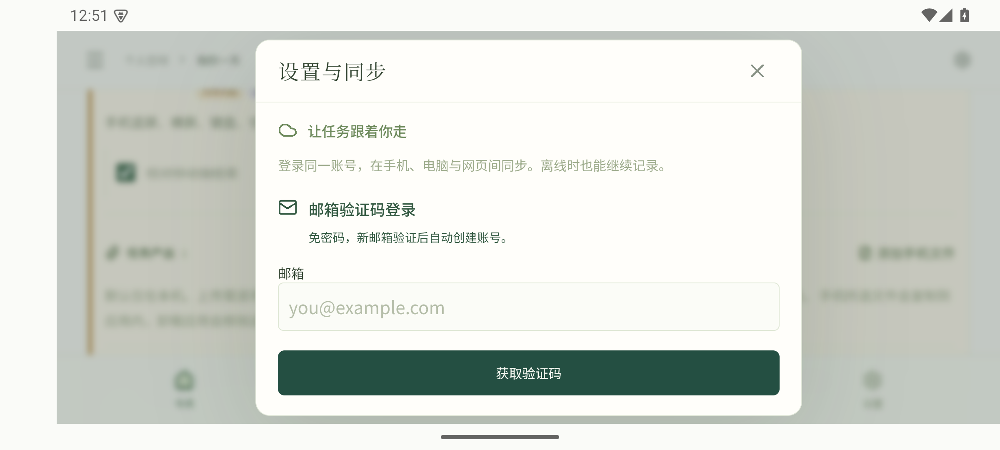
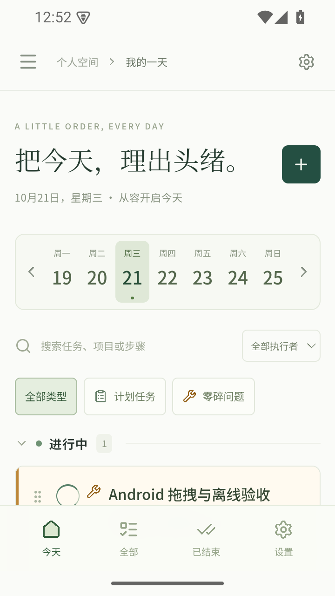

# Android 0.5.0 验证记录

验证日期：2026-10-21。安装包为正式签名 Release，包名 `app.dayweave.personal`，版本号 `0.5.0`，versionCode `5000`。包含 ARM64 与 x86_64，最低 Android 7.0，target SDK 36。

## 测试环境与边界

- 实际安装运行：Android 15 / API 35 的 Pixel 7 模拟器，x86_64，Android System WebView 124.0.6367.219。
- 手机尺寸：常规竖屏、横屏，以及通过系统分辨率与密度切换的 320 CSS 像素窄屏。
- 数据层：独立临时账号连接实际 Supabase；由另一个持有该账号会话的客户端核对数据库和文件内容。测试完成后，账号、任务、文件均已清理，查询确认剩余数量均为零。
- 模拟器外网 DNS 不可用时，通过本机代理恢复测试网络；代理仅设置在模拟器中，应用未内置代理。验证结束后清除该设置。

尚未使用实体 Android 手机验证，未覆盖每个品牌系统、旧版 WebView、32 位设备、长时间耗电及低内存压力。邮箱验证码的发送与错误处理通过自动化模拟响应验证，本轮没有发送真实验证码邮件。云端测试会话由隔离账号预置，这不等同于验证实际邮件投递。

## 已验证的行为

| 范围 | 验证内容 |
| --- | --- |
| 任务操作 | 创建、执行者自定义、零碎问题分类、子步骤勾选、状态切换、删除、分组折叠持久化 |
| 触摸操作 | 真实触摸事件拖动任务经过待办、进行中、已结束三个分组 |
| 布局 | 竖屏、横屏、320px 窄屏，无横向溢出；设置可达；软键盘弹出后保存按钮仍可操作 |
| 系统返回 | 先收起键盘，再关闭编辑或设置，主界面退出 |
| 本机附件 | 系统选择器复制文件、原文件移除后副本仍可读、逐字节核对、系统保存面板导出 |
| 备份 | 原生 JSON 导出、原生文件选择器导入为独立任务副本 |
| 离线 | 断开 Wi-Fi 和移动网络，强制结束进程后重开，任务、已勾选步骤和附件保留 |
| 双向云同步 | 安卓修改上传；另一客户端提交修改后，Realtime 回传到安卓界面 |
| 文件存储切换 | 默认无云端内容与本机路径；逐项确认后上传；另一客户端下载内容一致；手机下载缓存并唤起系统查看器；改回仅本机后云端对象为零、本机副本保留 |
| 账号隔离 | 退出云账号后返回独立的本机任务空间 |
| 自动顺延 | 通用逻辑及手机网页测试覆盖连续跨日、离线重开补齐、保留历史日期与已完成任务；安卓测试中的进行中任务也随跨日移动到新的一天 |

安卓云文件下载曾暴露 Tauri Android 不支持原始二进制请求体的问题，现改为有大小限制的 Base64 传输，并在更新的 APK 中完成下载与内容核对。

## 回归与构建检查

- 逻辑测试：18 项通过。
- Rust 本机文件与 ZIP 测试：1 项通过。
- 电脑与手机网页交互回归：28 项通过。
- 原生 Debug APK 的系统交互回归：16 组通过，脚本位于 `tests/android/`；运行方法见 [Android 说明](android.md)。
- 正式签名 Release APK 单独安装复测：7 组通过，覆盖压缩后启动、触摸创建任务、系统文件选择、本机查看与另存、设置返回、进程重启恢复及主页正常退出；清空日志后的本轮复测无应用崩溃记录。
- Release APK 已检查版本、ABI、最低系统版本、非调试标志、签名及 16 KB ZIP 对齐。

正式包大小为 12,732,272 字节，SHA-256：`3cf38d81af563a37631a7b4c4160fbc072b45147daed73097c4e93d86f8a8151`。

Release 安装曾发现插件初始化时 Jackson 枚举反射被代码压缩移除，已补入 Android 标准压缩配置并重新构建。正式包单独复测，不使用 Debug 测试结果替代。

正式签名密钥保存在开发机用户目录 `.dayweave/signing/`，没有提交到仓库。构建产物、测试账号凭证、SDK、NDK 和模拟器数据同样不提交。

## 界面截图

以下为模拟器内实际应用截图。

