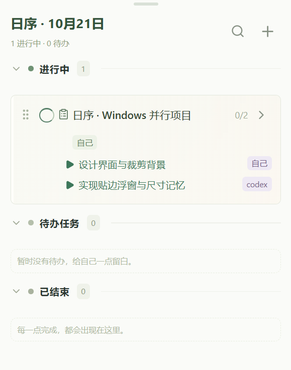
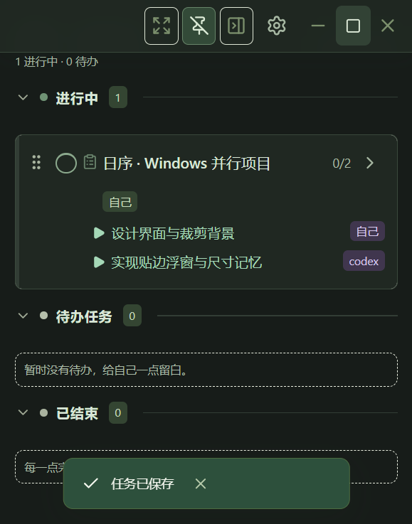

# Windows v0.6.0 使用与验证

2026-10-21。先使用内置 ImageGen 生成 [七个场景的设计稿](design/dayweave-windows-v060.png)，再开始编码；完整提示词在 [设计记录](design/windows-v060-prompts.md)。本轮发布 Windows x64 程序与 NSIS 安装包，未重建或替换 Android 包。

## 操作

1. 新建或编辑任务，在「任务背景」选择默认颜色、自选颜色，或「上传并制作背景」。支持 PNG/JPG/WebP，拖动选框、四角裁剪、方向键微调，选择比例和不透明度，命名后保存。保存的背景可重复选择或从素材库移除。
2. 子步骤可填写执行者，留空沿用任务执行者。「正在做」与「缩略显示」可分别选择，允许同时处理多项；完成的步骤自动从摘要消失。未配置过的旧任务显示第一个未完成步骤。
3. 精简窗口可拖动边缘调整大小，完整/精简切换和重新启动都会保留上次的精简尺寸。空闲时顶部按钮隐藏；将鼠标移到顶部细线或用键盘聚焦，可显示操作栏。
4. 精简窗口贴近屏幕边缘（约 16 逻辑像素内）后，鼠标移开约一秒，会缩成浮条。只显示当天排序最前的进行中任务；没有进行中时显示第一项待办。悬停或点击恢复，拖离边缘解除贴边。顶部的「贴边收起」按钮可关闭自动收起。
5. 「设置与同步 → 外观」默认「跟随系统」，也支持固定浅色或暗黑；切换系统颜色后无需重新打开。

## 保存与兼容

任务背景及素材库保存在当前应用 WebView 的独立 IndexedDB；不放进 Supabase 数据库、Storage、任务 API 或任务 JSON 备份。颜色设置也限当前电脑。删除素材不会删除原图文件。图片保存为最多 960×640 的 WebP，最多 40 张；原图限制 15MB、3200 万像素。文字始终完全不透明，并增加背景遮罩保持可读性。

子步骤的执行者、进行中与显示标记随任务 JSON 同步，并保留在任务备份中。现有个人 API 同步更新到 v1.1，未知字段与账号权限限制保持原有规则。旧客户端的兼容范围见 [接口说明](api.md)。

## 验证方法

自动检查使用本机 Edge 浏览器；原生检查运行实际 Windows Release 二进制，使用独立 WebView2 数据目录，不访问日常账号或当前运行的旧版任务数据。

```powershell
rtk npm test
$env:PLAYWRIGHT_CHANNEL='msedge'
rtk npm run test:e2e -- --project=desktop
rtk npm run desktop:build
powershell -NoProfile -ExecutionPolicy Bypass -File tests/windows/run.ps1
```

## 本次结果

- 29 项逻辑与接口测试通过，覆盖旧任务、并行步骤、备份、旧客户端编辑兼容、四边贴边几何、负坐标显示器、裁剪边界和自选灰阶颜色文字对比度。
- 34 项生产构建界面测试通过（17 桌面 + 17 手机尺寸浏览器回归）；验证颜色、裁剪后的实际蓝色像素、透明度、复用、重载和不自动上传。手机尺寸回归不代表本轮发布了 Android 包。
- 实际 Windows x64 Release 检查通过：本机 2880×1800 屏幕、175% 缩放；280×260、330×420、520×620 弹性布局；置顶、完整/精简互换；空闲隐藏与顶部悬停；原生深色主题；右侧贴边后收成约 64 逻辑像素浮条，移动真实系统鼠标可展开。
- 浮条状态关闭应用再重开，恢复展开时约 330×420 的大小，保留两个并行子步骤及置顶设置；实际 WebView2 内图片选择、Blob 预览、裁剪、保存及重载均通过。两组原生测试没有页面错误。
- API 已部署为 Edge Function 第 5 版、OpenAPI v1.1；独立临时账号验证新步骤字段在创建、局部修改与读取中保留，并复查鉴权、账号隔离与版本冲突。临时账号、任务、密钥均删除并确认计数为 0。
- 实机只覆盖当前单屏及 175% 缩放；负坐标多屏和其他边缘的几何经过单元测试，尚未在多屏硬件上验证。

交付文件（位于项目 `artifacts/release/`）：

| 文件 | 大小 | SHA-256 |
| --- | ---: | --- |
| DayWeave_0.6.0_x64.exe | 4,014,592 字节 | `38d156eb473e6931aa6fbe51b213fada198ce1e0be95e44308078010477ce5a3` |
| DayWeave_0.6.0_x64-setup.exe | 1,512,571 字节 | `71056e963cbf6f15e3b527fb8f5eaa6e965396d76fc368bae8d5931f9469b1bb` |

原生测试运行的是上表同一份可执行文件，程序与安装包版本信息均为 0.6.0。安装包生成成功，未在日常用户配置上执行覆盖安装；商业代码签名沿用项目原有未配置状态。






