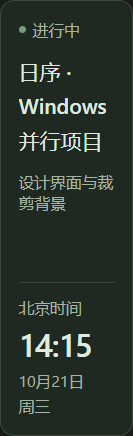

# Windows v0.6.1 浮条时钟

只更新 Windows 电脑版，不重建或替换 Android 包。按要求先用内置 ImageGen 生成 [浅色/深色、横向/竖向设计稿](design/dayweave-windows-v061-clock.png)，[完整提示词](design/windows-v061-prompts.md) 随源码保存。

## 使用

进入精简模式，将窗口贴近屏幕边缘，鼠标移开后浮条会自动收起。底部显示「北京时间」、24 小时时分、日期与星期。左右边的浮条为 76×248 逻辑像素，上下边为 280×72；主窗口和精简窗口的自定义尺寸记忆保持原有方式。悬停或点击即可展开。

时区固定为 `Asia/Shanghai`（UTC+8），与 Windows 当前时区无关。时间读取本机系统时钟，无需联网；本机时间错误时应校正 Windows 时钟。时分按分钟边界刷新，日期和星期在北京时间午夜同时切换。窗口重新显示、获得焦点或休眠后恢复时刷新；展开窗口后卸载时钟及其定时器。

## 验证

本轮检查覆盖北京时间跨年/午夜、美国夏令时切换、闰日。界面回归使用桌面浏览器，原生测试使用独立 WebView2 数据目录运行交付的 Windows 程序，不操作日常账号数据。

```powershell
rtk npm test
$env:PLAYWRIGHT_CHANNEL='msedge'
rtk proxy npx playwright test --project=desktop
rtk npm run desktop:build
powershell -NoProfile -ExecutionPolicy Bypass -File tests/windows/run.ps1 -Executable artifacts/release/DayWeave_0.6.1_x64.exe
```

结果：32 项逻辑测试、17 项桌面界面回归通过。实际 Windows Release 程序在 175% 缩放下通过四边浮条与悬停恢复、浅色/暗黑、全部时钟文字无溢出、按时跨越北京时间午夜和年界、模拟休眠后的焦点恢复刷新。原有精简尺寸记忆、置顶、并行步骤和本机背景功能的原生回归通过；没有页面错误。测试进程已退出。

安装包构建成功，未对日常用户配置执行覆盖安装。只验证当前电脑的单屏硬件；多屏负坐标和不同缩放的几何沿用单元测试覆盖。

## 交付文件

文件位于 `artifacts/release/`，程序版本均为 0.6.1。原生验证运行的就是下表同一份程序。

| 文件 | 字节数 | SHA-256 |
| --- | ---: | --- |
| DayWeave_0.6.1_x64.exe | 4,015,616 | `96fa07ce90b1c7795398805b9d5d8803e2f9a0195bd57d5d9e19909ce46857c1` |
| DayWeave_0.6.1_x64-setup.exe | 1,513,532 | `0eebe2fbd94ea5e86a34aad91a124c7d7c8d3829eda870ab806cebd878723d2d` |

## 实际程序截图




浅色截图使用测试时钟，展示模拟休眠恢复后的北京时间 2027-01-02 12:35；不代表截图拍摄日期。


