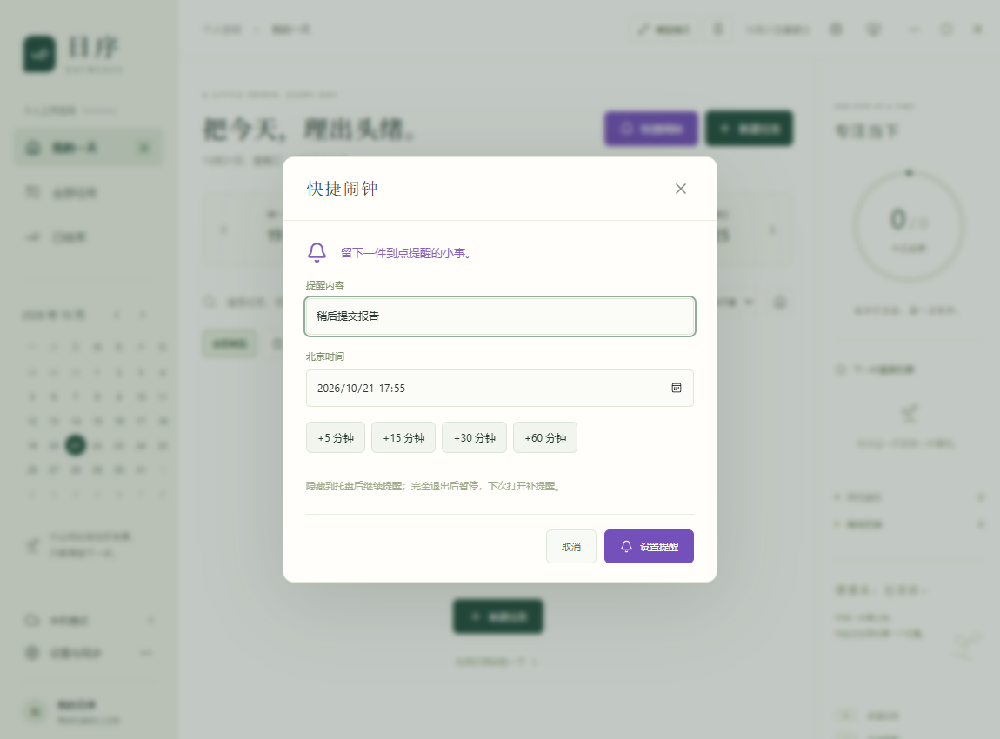
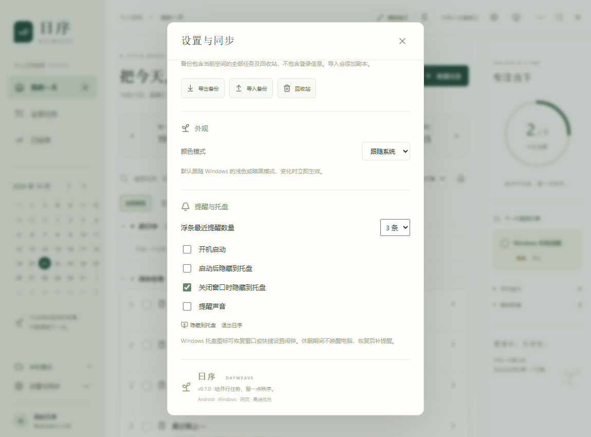

# Windows v0.7.0 闹钟、截止时间与托盘

仅发布 Windows 电脑版，不重建或替换 Android 安装包。先使用内置 ImageGen 生成 [设计稿](design/dayweave-windows-v070-reminders.png)，再编码；[完整提示词](design/windows-v070-prompts.md) 随源码保存。

## 使用

- 主界面和精简窗口均提供「快捷闹钟」。输入内容、选择北京时间，或点击 +5 / +15 / +30 / +60 分钟，保存即可。紫色铃铛与独立类型筛选用于区分闹钟。
- 普通任务编辑器中可选「截止时间（北京时间）」。提前提醒支持到点、提前 5 / 15 / 30 / 60 分钟，或不提醒。安排日期与截止时间彼此独立。
- 到点后弹出独立置顶窗口，多项提醒逐条排列。「5 分钟后」延迟本次提醒，「我知道了」保留任务状态且停止本次提醒，「完成任务」将任务标记完成。右上角叉号知晓全部当前提醒。
- 修改提醒时间会生成新的提醒；完成或删除任务停止提醒。重新打开已完成任务时，若提醒时间已过且本机未知晓，会补提醒；已知晓的同一次提醒保持知晓状态。
- 精简窗口贴边收起后，当前任务与北京时间时钟之间显示最近截止任务，按截止先后排序，跨全部安排日期。在「设置与同步 → 提醒与托盘」选择显示 1～5 条；已结束、删除和已过期的截止任务不占浮条位置，到期事项通过置顶窗口处理。
- 右上角「隐藏到托盘」可隐藏主窗口。Windows 右下角通知区域的日序图标可恢复窗口，右键菜单提供显示日序、快捷闹钟、查看到期提醒、切换提醒声音、退出日序。Windows 可能把图标收在通知区域的上箭头中。
- 同一区域可设置开机启动、启动后隐藏到托盘、关闭窗口时隐藏到托盘和提醒声音。默认开机启动关闭、启动隐藏关闭、关闭窗口隐藏开启、声音开启。开启自启时建议使用安装版，避免移动便携程序导致启动路径失效。

## 时间与数据

时间输入和显示始终使用北京时间 `Asia/Shanghai`（UTC+8），与 Windows 当前时区、夏令时无关；提醒依赖电脑的系统时钟。无需联网即可对本机已经保存的任务计时。

原生后台每秒检查到期事项，独立于主窗口的页面定时器。隐藏到托盘后仍运行；完全退出、关机和休眠期间不会提醒或唤醒电脑，恢复应用运行后补提醒。当前版本为一次性提醒。

任务的闹钟标记、截止时间和提醒时间随原有账号同步。已知晓、5 分钟稍后提醒以及开机/托盘偏好仅保存于当前 Windows 设备，不跨设备同步；多台 Windows 同时运行时可能各自提醒。退出账号后只处理当前空间的任务。

个人任务 API 已升级至 v1.2 并部署，支持 `alarm`、`deadlineAt`、`reminderAt`。沿用个人密钥、权限隔离、幂等键与版本检查；详见 [中文接口文档](api.md) 和 [OpenAPI](api.openapi.json)。为兼容旧版 Android，闹钟序列化的 `kind` 仍为 `planned`，由可选 `alarm=true` 区分。旧版编辑的兼容边界见接口文档。

## 验证

```powershell
rtk npm test
$env:PLAYWRIGHT_CHANNEL='msedge'
rtk proxy npx playwright test --project=desktop
rtk cargo test --lib --manifest-path src-tauri/Cargo.toml
rtk npm run desktop:build
powershell -NoProfile -File tests/windows/run.ps1 -Executable artifacts/release/DayWeave_0.7.0_x64.exe
```

37 项逻辑测试、2 项 Rust 测试和 18 项桌面浏览器回归通过。覆盖美国时区下的北京时间输入、闹钟持久化/筛选/完成、普通任务提前提醒，以及原有任务、步骤、背景、验证码和响应布局。

Windows 原生测试使用交付程序和独立 WebView2 目录，避免日常账号数据。覆盖主页面隐藏与页面生命周期冻结期间的两项置顶提醒、5 分钟稍后记录、完成落盘、知晓跨刷新保留、关闭后驻留、启动隐藏、重启补提醒，以及真实 Windows 自启注册项的启用/查询/关闭。原生测试注册名为 `DayWeave Native Test`，结束时移除该项；未操作日常应用的启动设置。

原有窗口尺寸记忆、置顶、空闲工具栏、四边悬停展开、北京时间时钟、并行步骤、图片裁剪和系统主题继续进行原生回归。四边浮条同时显示五项截止任务和时钟均无溢出。当前硬件为单屏、175% 缩放；自动化调用托盘使用的原生动作，未模拟重启 Windows、真实系统休眠或手动点击通知区域菜单。声音开关经过状态检查，测试期间关闭声音。

云端接口使用两个临时测试账号，验证闹钟字段创建/读取/修改保留、幂等重试、删除、版本冲突和跨账号隔离；测试账号、密钥及任务均已清理，残留计数为零。

## 交付文件

安装包构建成功；未覆盖安装日常用户正在运行的版本。两个文件的产品版本均为 0.7.0。

| 文件 | 字节数 | SHA-256 |
| --- | ---: | --- |
| DayWeave_0.7.0_x64.exe | 4,224,512 | `365a85bd99e41d66dc381e5b15a6444cf93096061a831cb53660316904499523` |
| DayWeave_0.7.0_x64-setup.exe | 1,580,649 | `d7bfa3782734c69da04600bedb5d8b0618ed25377b542869830371761cfe7a44` |

## 实际程序截图







